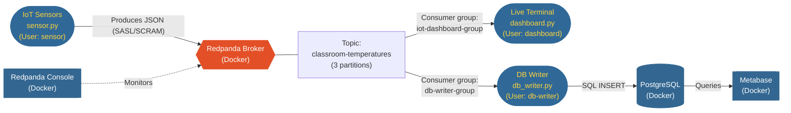

# Decoupled IoT Event Streaming Architecture

[](https://youtu.be/w3ypnW0UWHc)

*The video shows an earlier version; a re-recording is planned after the outage-recovery demo.*

## Overview
This project demonstrates an event-driven architecture designed to solve a common IoT challenge: point-to-point data silos, which become fragile, tightly coupled, and hard to change as more systems are connected.

To solve this, a Redpanda event broker sits at the center of the infrastructure, decoupling edge sensors from the downstream systems that consume their data.

If the database goes down, sensors keep sending, and readings wait in the broker (up to the topic’s 7-day retention period). New consumers, like the database writer, can be added without changing the sensor code.

Built with pre-sales engineering in mind, this project emphasizes business value through technical architecture. It uses production patterns (authentication, least-privilege service accounts, and infrastructure as code) and showcases fan-out, containerized orchestration, and real-time data visualization.

## Architecture & Data Flow



## Key Technical Features

* **Decoupling:** Producers and consumers never communicate directly; each talks only to the broker. A database outage doesn't stop the sensors from collecting data.
* **The Fan-Out Pattern:** One stream of telemetry is read independently by two consumer groups at the same time: the live terminal dashboard (`iot-dashboard-group`) and the database writer (`db-writer-group`).
* **Authentication & Least Privilege:** The cluster requires SASL/SCRAM authentication, so there are no anonymous connections. Each service has its own account: the sensor can only write, and the consumers can only read. Accounts and permissions are defined in code by a setup script designed to be safely re-run.
* **Infrastructure as Code / Reproducibility:** The whole stack (message broker, Redpanda Console, PostgreSQL, and Metabase) runs from a single `docker-compose.yml` on a shared Docker network. One command brings everything up, image versions are pinned, and secrets live in a gitignored `.env`, with `.env.example` as the committed template.

### Security model

| Account | Used by | Permissions |
|---|---|---|
| `sensor` | `sensor.py` | Write and Describe on `classroom-temperatures` |
| `dashboard` | `dashboard.py` | Read and Describe on `classroom-temperatures`; Read on group `iot-dashboard-group` |
| `db-writer` | `db_writer.py` | Read and Describe on `classroom-temperatures`; Read on group `db-writer-group` |
| `superuser` | Setup jobs and Console | Cluster administration |

Accounts and ACLs are created by `setup/create-users-acls.sh`, which runs automatically on `docker compose up` and is safe to re-run. All passwords come from `.env`, which is never committed.

## Tech Stack

* **Event Streaming:** Redpanda v26.2.2 (Kafka API-compatible), Redpanda Console v3.11.0
* **Languages:** Python 3.14.7 (confluent-kafka, psycopg2-binary, python-dotenv; pinned in `requirements.txt`)
* **Storage:** PostgreSQL 15
* **Visualization:** Metabase v0.64.3.4
* **Orchestration:** Docker Compose

---

## Prerequisites

- Docker Desktop (running)
- Python 3.14 or newer
- Git

## Quick Start

### 1. Clone and configure
```bash
git clone https://github.com/edgnunez/iot-redpanda-pipeline.git
cd iot-redpanda-pipeline
cp .env.example .env        # Windows PowerShell: Copy-Item .env.example .env
```
Edit `.env` and set your own passwords **before** the first start. Passwords are applied only when the broker and database are first created.

### 2. Start the infrastructure
```bash
docker compose up -d
docker compose ps -a
```
Wait until `redpanda-0` and `postgres` show `(healthy)`. The one-time setup jobs, `createtopic` and `security-setup`, should show `Exited (0)`.

### 3. Set up Python
```bash
python -m venv .venv
source .venv/bin/activate   # Windows PowerShell: .\.venv\Scripts\Activate.ps1
pip install -r requirements.txt
```
On Windows, if activation is blocked, run `Set-ExecutionPolicy -Scope CurrentUser RemoteSigned` once and try again.

### 4. Run the pipeline
Open three terminals (activate the virtual environment in each) and start, in this order:
```bash
python scripts/db_writer.py
python scripts/dashboard.py
python scripts/sensor.py
```

### 5. Explore
- **Redpanda Console:** http://localhost:8080 (topics, messages, consumer group lag, users and ACLs)
- **Metabase:** http://localhost:3000. On first launch, add a PostgreSQL database with host `postgres`, port `5432`, database `iot_data`, user `admin`, and the `POSTGRES_PASSWORD` from your `.env`.

_Note: Metabase may take 1-2 minutes to initialize on port 3000 and will ask you to create an admin account before you can add the database._

### Stopping and resetting
```bash
docker compose down      # stop; data is kept
docker compose down -v   # stop and delete all data (fresh start)
```

---

## Known limitations and roadmap
* There is only a single broker, so there isn't any replication; production would run at least three.
* TLS is not implemented, so credentials and data cross the network unencrypted (planned: add TLS to the client listener).
* `db_writer.py` auto-commits offsets and skips errors, so a failed insert can lose a message (planned: commit offsets only after a successful insert, then demo outage recovery).
* The sensor doesn't send a message key, so there's no per-classroom ordering guarantee (planned: key messages by classroom).
* Console uses the superuser account.
* The `.env` passwords are for local development; production would use a secrets manager.